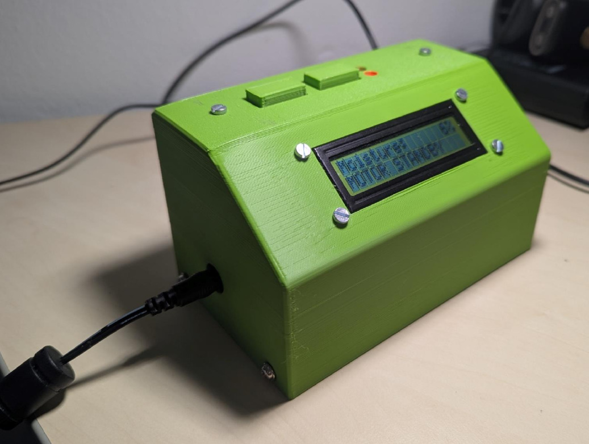

## AVR-Based Automatic Plant Watering System

  

An embedded system designed to automate the process of watering houseplants by monitoring capacitive sensor values. The device detects soil moisture and activates a motorized pump to supply water when the moisture falls outside a user-defined range.

#### Core Features
* **Automated Irrigation:** Monitors soil moisture and runs a 5V pneumatic pump until the target moisture range is satisfied.
* **Custom Thresholds:** Allows users to define specific minimum and maximum moisture bounds.
* **Persistent Storage:** Saves user presets to the ATmega328P's EEPROM, which are then automatically loaded upon device startup.
* **Safety Shutoff:** Includes an emergency shutoff feature that powers down the device if sensor values show little to no change while the pump is running, protecting against failure.
* **Live Status Interface:** Displays current moisture readings, target ranges and motor status on a 16x2 character I2C LCD.

#### Hardware Architecture

* **Microcontroller:** ATmega328P 8-Bit RISC CPU operating at 16MHz with 32KB of flash storage and 1KB of EEPROM.
* **Mainboard:** Custom 2-layer FR-4 PCB (66mm x 78mm) integrating a motor controller section, I/O pin headers, ISP, and UART connectors.
* **Sensors & Actuators:** Utilizes an Adafruit I2C capacitive moisture sensor (equipped with an onboard Seesaw controller) and a 5V pneumatic water pump.
* **Enclosure:** Housed in a custom-designed and compact 3D-printed two-part PLA case (138mm x 85mm x 80mm) assembled with threaded M3 screw inserts.

#### Software Implementation Highlights 
* **Bare-Metal C:** Written in bare-metal C utilizing standard [AVR macros](https://github.com/avrdudes/avr-libc/blob/main/include/avr/io.h), resulting in a binary with a total size of 6KB.
* **Custom Drivers:** Employs self-written libraries for TWI and UART communication to interact with hardware units.
* **Component Libraries:** Includes dedicated driver files for the LCD and the Adafruit capacitance sensor.
* **Debugging:** Allows for verbose status output routed to the UART interface for debugging.

#### Repository Contents
The project repository contains the following files:
* **[Circuit](./Circuit)**: Altium project files, including final Gerber files, Drill files, and the component Bill of Materials (BOM).
* **[Firmware](./Firmware)**: Complete software source code and custom header libraries.
* **[Enclosure](./Enclosure)**: FreeCAD project files and STL models for the enclosure.

#### User Interface and Controls 
The User Interface is controlled via a set of two buttons on top of the device. The right button cycles (MODE) between menus while the left button (SET) is used to cycle between setting of the respective menu
In total there are 3 different menu screens:

**Monitoring Mode**

The default state displaying the current moisture percentage and target range. with an option to disable the motor using the SET button.

**Set Mode**

Two menu screens allowing to manually adjust the minimum and maximum moisture thresholds. By pressing the SET button, the value is increased by 10%. After reaching the Max value, it cycles back to the Min value. Settings are saved immediately.

**Store Mode**

Two menu options allowing the user to save current settings into a preset slot or load them from EEPROM using the SET button. Alternatively, the stored preset is loaded on boot.

